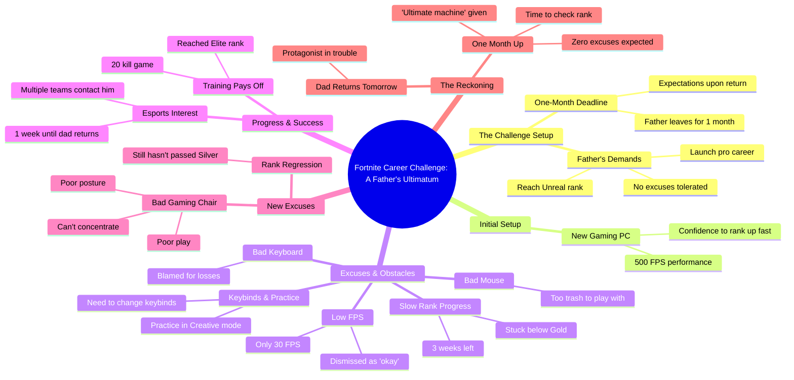

# Strawberry vs Kiwi Race to Unreal Rank in Fortnite

> 🌐 **Read this in:** [English](../../en/2026-10/tiktok-transcript-who-will-reach-the-unreal-rank-first-vs-brainrot-ai-fortnite-11c5.md) · **中文**

> **Creator:** [@thedogfather.tv](https://www.tiktok.com/@thedogfather.tv) · **Views:** 1.6M · **Posted:** 2026-10-12 · **Niche:** entertainment
>
> **TL;DR:** The hook immediately grabs attention with a shocking and humorous parental command that sets up the entire narrative.

[Watch original video →](https://www.tiktok.com/@thedogfather.tv/video/7689199943046679830?is_from_webapp=1&sender_device=pc&web_id=7652449168514991629)

## Why This Went Viral

## 钩子（前3秒）
- **逐字开场白：**“从今天起，我命令你靠《堡垒之夜》闯出一番事业。”
- **钩子模式：**大胆命令／权威人物下最后通牒（“严厉父母下达不可能任务”的设定）。
- **为什么能让人停下滚动：**它融合了两件观众无法忽视的事——高风险的父母要求和“去打《堡垒之夜》职业”的荒诞前提。“命令”一词暗示冲突，而游戏语境承诺要么是令人满足的胜利，要么是壮观的失败。瞬间制造好奇缺口：*这孩子能做到吗？*

## 情绪节奏
- **第1拍——好奇（0–5秒）：**爸爸的最后通牒＋“我在你身上看到的潜力比你哥哥大”埋下竞争种子和期限（1个月）。
- **第2拍——自信→摩擦（前期）：**“500帧，我马上就能变成Unreal” → 紧接着“这鼠标太垃圾了。”
- **第3拍——不断升级的借口循环（张力累积）：**每件装备（鼠标→键盘→椅子）都成为失败的替罪羊。段位倒退：黄金→白银，期限压缩：3周→1周→明天。
- **第4拍——虚假胜利（反转）：**“20杀，我是精英，电竞战队联系我了”——希望飙升，却立刻被“这电竞椅太垃圾了”打断。
- **第5拍——高潮：**“爸爸明天回家。现在我真的有麻烦了。”最高风险＋零进展。
- **第6拍——回报铺垫：**“是时候看看我的冠军有没有打上Unreal了。”悬念落在门打开的那一刻——揭晓被刻意保留，推动评论和重看。

## 关键词密度
- **“Unreal”**——渴望达成的目标；算法友好的游戏关键词＋情绪目标。
- **“垃圾”**——反复出现的借口词（鼠标、键盘、椅子）；推动喜剧节奏。
- **“爸爸／父亲”**——锚定家庭 stakes 的情绪牵引。
- **“段位”**（黄金／白银／精英）——游戏原生术语，提升垂类触达。
- **“FPS”／“PC”**——硬件关键词，向游戏受众传递真实感。
- **“借口”**——主题脊柱；为视频首尾呼应。
- **“回家”**——反复出现的期限短语，制造张力。
- **触达驱动词：** *Fortnite、Unreal、FPS、段位、电竞*——这些喂养游戏算法和搜索。
- **情绪牵引驱动词：** *爸爸、哥哥、骄傲、麻烦、借口*——这些让内容超越玩家群体，变得可共鸣。

## 为什么它会传播
- **通用的“怪装备”笑话：**每个玩家（以及每个拖延者）都认得“这鼠标太垃圾了”／“这键盘太垃圾了”／“这椅子太垃圾了”——这是对数百万人都有的行为的自我意识式调侃。
- **倒计时结构：**期限不断压缩（1个月→3周→1周→明天），迫使观众持续观看结果——经典的留存装置。
- **家庭 stakes 的共鸣：**“我在你身上看到的潜力比你哥哥大”和“他会骄傲的”把一段游戏片段变成任何人都能感受到的父子压力故事。
- **预期颠覆：**“20杀，精英，电竞联系我了”这句先引诱一个幸福结局，然后用“这电竞椅太垃圾了”把它拽走——这个反转就是可分享的瞬间。
- ** withheld payoff：**以“是时候看看我的冠军有没有打上Unreal了”结尾，拒绝给出结局，推动评论（“他做到了吗？”）和重看。

## 你可以偷师的点
1. **用权威最后通牒＋期限开场。**带有倒计时的命令（“你有1个月，不许找借口”）会瞬间制造 stakes 和看到结尾的理由。
2. **使用重复升级装置。**“X是垃圾”的循环加上不断缩短的时间窗口，是一个简单、好笑的引擎，能让观众持续上头——找到你自己的可重复节拍。
3. **伪造胜利，然后拆掉它。**在真正反转前给观众一个虚假高潮（“我是精英，战队联系我了”）——这是人们截图和分享的时刻。
4. **保留最终结果。**以门打开而不是答案结尾；未解决的结局会刺激评论和重播。

## Mind Map

## Full Transcript (Generated by [TokTranscript 转录工具](https://toktranscript.com/?utm_source=github&utm_medium=breakdown&utm_campaign=tool_attribution))

> 📝 Transcripts on this page are auto-generated and show the first 60%. Want to transcribe any TikTok in 30 seconds and get the full version? [Try TokTranscript free →](https://toktranscript.com/?utm_source=github&utm_medium=breakdown&utm_campaign=transcript_cta)

Starting today, I order you to make a career on Fortnite. You. I bought you the best PC. I see a lot more potential in you than in your brother. You do your best. I'm not expecting much. Anyway, I'm leaving for 1 month. When I return I want to see you. Unreal and already launched in a pro career. No excuses. With my PC running at 500 fps, I'm gonna become unreal in a flash. What? But seriously, this mouse is too trash. I can't play like this. Well it only runs at 30 fps, but honestly it's okay. Before starting a game I need to change my key binds and practice a bit in creative mode. But it's not possible. This keyboard is trash. I swear I lose because of the keyboard. I still haven't passed the gold rank and dad comes home in 3 we

*[Read the full transcript on TokTranscript →](https://toktranscript.com/plaza/tiktok-transcript-who-will-reach-the-unreal-rank-first-vs-brainrot-ai-fortnite-11c5?utm_source=github&utm_medium=breakdown&utm_campaign=transcript_full)*

## Browse More

- All [entertainment](../../by-niche/zh-CN/entertainment.md) breakdowns
- All [Direct Command + Absurd Premise](../../by-pattern/zh-CN/hook-direct-command-absurd-premise.md) examples

## Video Info

| | |
|---|---|
| Creator | [@thedogfather.tv](https://www.tiktok.com/@thedogfather.tv) |
| Original video | [https://www.tiktok.com/@thedogfather.tv/video/7689199943046679830?is_from_webapp=1&sender_device=pc&web_id=7652449168514991629](https://www.tiktok.com/@thedogfather.tv/video/7689199943046679830?is_from_webapp=1&sender_device=pc&web_id=7652449168514991629) |
| Original title | Who will reach the UNREAL RANK first? 🍓 vs 🥝 #brainrot #ai #fortnite ... |
| Views | 1.6M (1600000) |
| Posted | 2026-10-12 |
| Duration | 0s |
| Niche | `entertainment` |
| Hook pattern | `Direct Command + Absurd Premise` |
| Original language | `en` (this page translated by AI) |
| Available languages | en, zh-CN |
| Generated | 2026-10-13 by [TokTranscript](https://toktranscript.com/) |

---

*This breakdown is for educational analysis under fair use. Original video © [@thedogfather.tv](https://www.tiktok.com/@thedogfather.tv). All transcripts are auto-generated and may contain errors.*

*Want to analyze your own TikToks like this? [TikTok 转录工具 →](https://toktranscript.com/viral-breakdown?utm_source=github&utm_medium=breakdown&utm_campaign=footer_cta)*