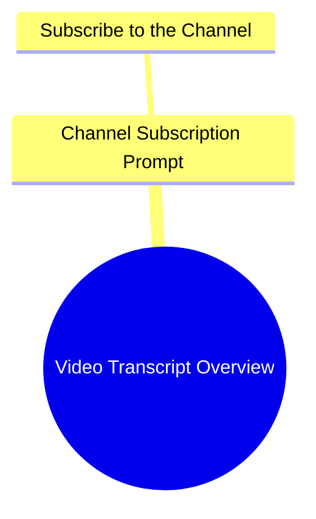

# The Unseelie Jig Song Lyrics

> 🌐 **Read this in:** [English](../../en/2026-11/tiktok-transcript-the-unseelie-jig-lyrics-fyp-4u-vibe-c486.md) · **中文**

> **Creator:** [@lofiofficial](https://www.tiktok.com/@lofiofficial) · **Views:** 132.6K · **Posted:** 2026-11-01 · **Niche:** entertainment
>
> **TL;DR:** The opening is just music followed by a subscribe request, so there is no verbal hook to grab attention.

[Watch original video →](https://vt.tiktok.com/ZSgwgwLer/)

## Why This Went Viral

## 钩子（前3秒）
- 逐字内容：一段音乐提示音响起，然后一个声音说“اشتركوا في القناة”（“订阅频道”）。
- 模式：直接行动号召／命令式钩子（无主张、无提问、无场景）。
- 为什么能阻止滑动：它并没有赢得注意力——它是在借用注意力。音乐提示音制造了模式中断，而订阅命令只对已被缩略图／标题预先调动的观众起到摩擦测试的作用。单就这个开场而言，它的阻止滑动能力接近于零；请把它当作一个数据点，而非范本。

## 情绪节奏
- 节拍1（0–3秒）：中性警觉——音乐＋订阅命令。没有打开任何好奇心缺口。
- 节拍2：缺失——文字记录中没有后续的张力、利害关系或故事节拍。
- 悬念：未建立。
- 共鸣：未建立。
- 反转：无。
- 高潮：无——文字记录在哪里开始就在哪里结束。
- 诊断：没有可映射的情绪弧线。这个视频无论有什么留存率，都来自音频轨道之外（画面、剪辑、屏幕文字）。仅凭文字记录无法解释病毒式传播；机制存在于缺失的那一层。

## 关键词密度
- “موسيقى”（音乐）——重复两次；表明是音频驱动的内容，驱动的是品类联想，而非情绪。
- “اشتركوا”（订阅）——唯一的祈使句；驱动转化意图，算法触达弱。
- “القناة”（频道）——与上者配对；CTA词汇。
- 没有细分领域关键词，没有主题名词，没有情绪化语言。
- 结论：就算法触达而言，关键词密度实际上为零。这里没有任何东西告诉推荐系统这个视频是*关于*什么的——没有主题信号，没有搜索意图，没有语义集群。

## 为什么它会传播
- 它很可能不是靠这段文字记录传播的。音频是一段音乐铺底加一个CTA——一个空壳，而非内容。
- 任何传播都应归因于视觉／剪辑层或外部分发推动，而非口播钩子或叙事。
- 在第一秒就发出订阅命令是一种留存*过滤器*，而非增长驱动力：它转化的是已经投入的观众，排斥的是冷观众。
- “موسيقى”的重复表明视频是音乐主导的——这种格式的病毒式传播来自曲目的熟悉度或某个同步时刻，两者在文本中都不可见。
- 底线：这段文字记录是不充分的证据。不要从一个CTA和一段音乐提示中逆向工程出病毒式传播公式。

## 你可以借鉴什么
- 绝不要以冷开场直接要求订阅。把CTA移到第一个回报节拍之后；改为前置一个主张、问题或场景。
- 如果你的格式是音乐主导的，让*第一个可听见的秒*成为可识别的钩子（一句歌词、一个drop、一个节拍签名）——曲目就是你的钩子，所以要用它最强的2秒开场。
- 添加一句口播或屏幕文字，明确点出主题。在零主题关键词的情况下，算法没有可索引的内容，冷观众也没有可抓取的东西。

## Mind Map

## Full Transcript (Generated by [TokTranscript 转录工具](https://toktranscript.com/?utm_source=github&utm_medium=breakdown&utm_campaign=tool_attribution))

> 📝 Transcripts on this page are auto-generated and show the first 60%. Want to transcribe any TikTok in 30 seconds and get the full version? [Try TokTranscript free →](https://toktranscript.com/?utm_source=github&utm_medium=breakdown&utm_campaign=transcript_cta)

موسيقى موسيقى اشتر

*[Read the full transcript on TokTranscript →](https://toktranscript.com/plaza/tiktok-transcript-the-unseelie-jig-lyrics-fyp-4u-vibe-c486?utm_source=github&utm_medium=breakdown&utm_campaign=transcript_full)*

## Browse More

- All [entertainment](../../by-niche/zh-CN/entertainment.md) breakdowns
- All [Music Bed With Subscribe CTA](../../by-pattern/zh-CN/hook-music-bed-with-subscribe-cta.md) examples

## Video Info

| | |
|---|---|
| Creator | [@lofiofficial](https://www.tiktok.com/@lofiofficial) |
| Original video | [https://vt.tiktok.com/ZSgwgwLer/](https://vt.tiktok.com/ZSgwgwLer/) |
| Original title | the unseelie jig #lyrics #fyp #4u #vibe  |
| Views | 132.6K (132600) |
| Posted | 2026-11-01 |
| Duration | 0s |
| Niche | `entertainment` |
| Hook pattern | `Music Bed With Subscribe CTA` |
| Original language | `en` (this page translated by AI) |
| Available languages | en, zh-CN |
| Generated | 2026-11-02 by [TokTranscript](https://toktranscript.com/) |

---

*This breakdown is for educational analysis under fair use. Original video © [@lofiofficial](https://www.tiktok.com/@lofiofficial). All transcripts are auto-generated and may contain errors.*

*Want to analyze your own TikToks like this? [我们用的转录工具 →](https://toktranscript.com/viral-breakdown?utm_source=github&utm_medium=breakdown&utm_campaign=footer_cta)*